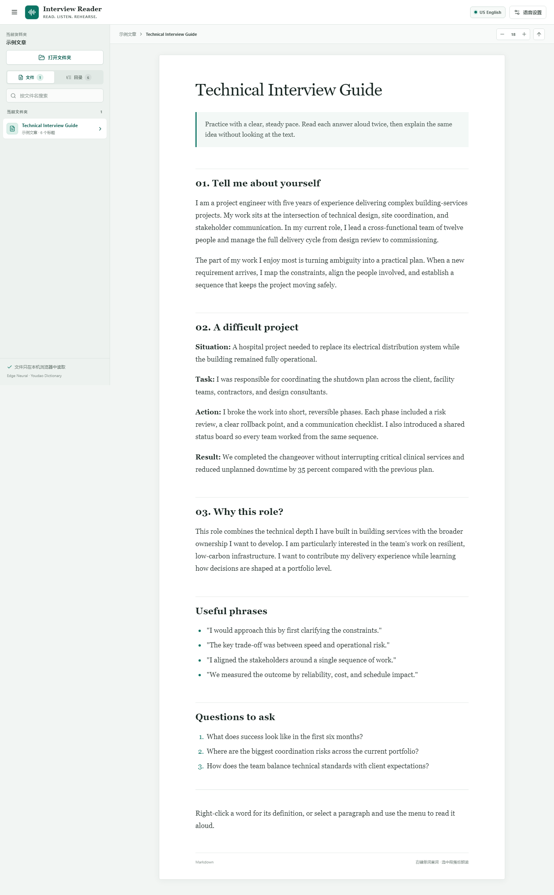
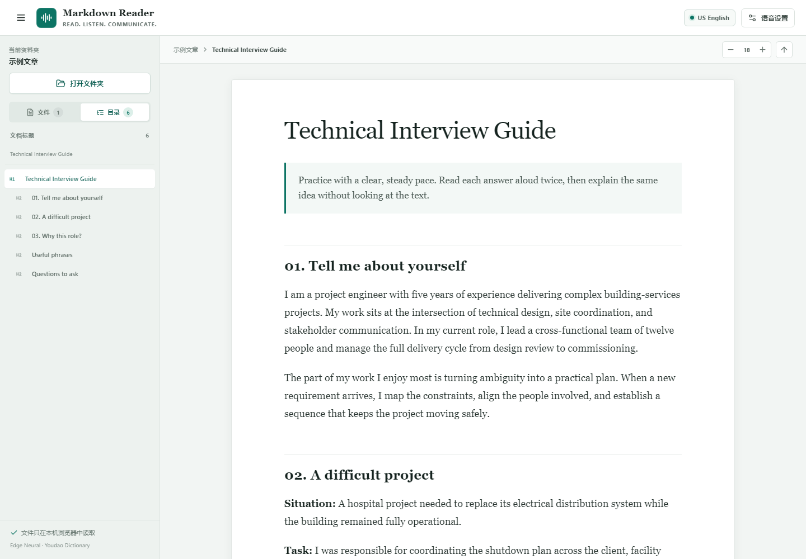
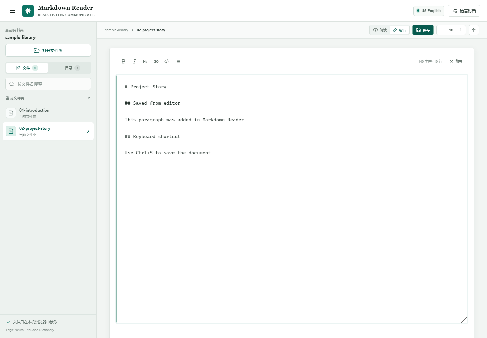
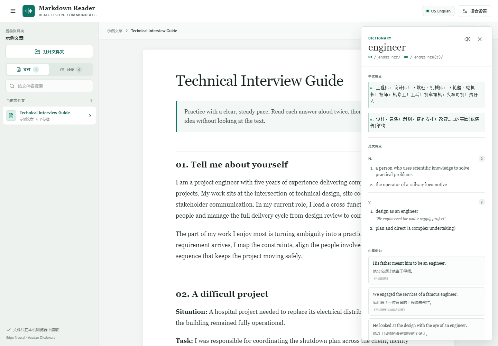
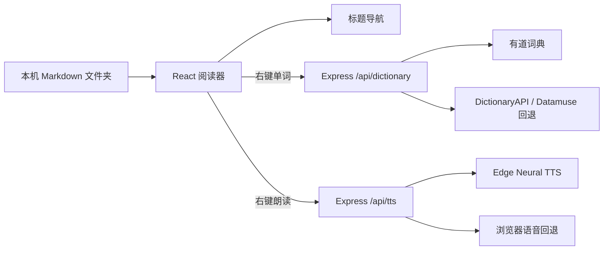

# Markdown Reader

面向英文会议、英文面试和技术交流的本地 Markdown 阅读、标题导航、字典查询与美式发音工具。

当前版本：`0.2.1`

Markdown Reader 把会议材料、面试稿、项目故事和常用表达集中在一个专注的阅读工作台里。你不需要在编辑器、翻译网站和朗读工具之间来回切换，就可以完成阅读、查词和跟读练习。



## 解决的痛点

参加英文会议、英文面试或跨国项目沟通时，材料通常散落在多个 Markdown 文件中，阅读、查词和跟读往往需要三个以上工具：

- 在编辑器阅读英文答案时，遇到生词要切到浏览器查词。
- 英文词典通常只有英文释义，缺少中文解释和双语例句。
- 系统朗读声音不一致，部分浏览器或内嵌环境甚至没有可用语音。
- 长文档缺少标题导航，反复滚动会打断练习节奏。
- 把完整面试稿上传到在线工具，会带来隐私和资料泄露风险。

Markdown Reader 将文件阅读、标题跳转、单词查询和美式朗读整合到一个界面中。文件内容只在本机浏览器读取；只有用户主动选中的文本或查询词会发送给本地 API，再由本地服务请求外部语音或词典服务。

## 功能

### 本地 Markdown 阅读

- 选择本机文件夹，只读取当前文件夹根目录下的 `.md` 和 `.markdown` 文件。
- 不加载子文件夹内容，避免目录嵌套造成文件列表混乱。
- 支持文件名搜索、文件切换和 Markdown 安全渲染。
- 桌面端和移动端均提供可收起、可重新打开的左侧导航。

### Markdown 标题导航

- 左侧“目录”根据当前文档的 `H1` 至 `H6` 自动生成。
- 点击标题可平滑跳转，并高亮当前阅读位置。
- 导航支持层级缩进，适合较长的面试稿和技术笔记。



### Markdown 编辑与保存

- 在“阅读 / 编辑”模式之间切换，直接修改 Markdown 源码。
- 支持加粗、斜体、二级标题、链接、行内代码和无序列表快捷插入。
- 使用 `Ctrl+S` / `Cmd+S` 保存；Chrome/Edge 授权后可覆盖原文件。
- 浏览器上传模式无法直接覆盖原文件时，会安全下载修改后的 `.md` 副本。
- 切换文件或关闭页面时会提示未保存修改，保存后标题导航自动刷新。
- 从编辑模式返回阅读时，自动定位到光标所在段落，不再回到文档顶部。



### 美式朗读

- 在正文中右键，可朗读当前英文段落或选中文本。
- 默认使用服务端 Edge Neural 美式语音，提供 Ava、Andrew、Aria、Guy 等声音。
- 支持语速调整、暂停、继续和停止。
- 在线语音不可用时，自动回退到浏览器本地语音。

### 中英词典与双语例句

- 右键单词即可查询。
- 优先展示中文释义、英文释义、美式/英式音标和双语例句。
- 支持一键播放单词发音。
- 有道数据不可用时，依次回退到 DictionaryAPI 和 Datamuse。



## 快速开始

### 环境要求

- Node.js 20 或更高版本
- npm 10 或更高版本
- 推荐使用最新版 Chrome 或 Edge

### 开发模式

```bash
git clone https://github.com/iamyoyo111/markdown-reader.git
cd markdown-reader
npm install
npm run dev
```

打开：

```text
http://127.0.0.1:4173/
```

`npm run dev` 会同时启动 Vite 前端和 Express 本地 API 服务。

### 生产构建

```bash
npm run build
npm start
```

生产版本同样通过 `http://127.0.0.1:4173/` 访问。可以通过 `PORT` 环境变量修改端口：

```powershell
$env:PORT=8080
npm start
```

## 使用方法

1. 点击左侧“打开文件夹”，选择包含面试稿的目录。
2. 在“文件”页切换当前目录下的 Markdown 文档。
3. 在“目录”页点击标题，快速跳转到目标章节。
4. 右键正文中的英文单词，选择“查询字典”。
5. 选中一段英文，或直接右键当前段落，选择“朗读”。
6. 点击顶部“编辑”修改 Markdown，使用 `Ctrl+S` 或保存按钮写回文件。
7. 在右上角“语音设置”中切换声音、朗读引擎和语速。

仓库中的 `sample-library/` 提供了可直接打开的示例材料。其中 `nested/ignored.md` 用于说明子文件夹内容不会被加载。

## 隐私说明

- 不上传完整 Markdown 文件，不包含账号系统、遥测或广告。
- 文件通过浏览器 File System Access API 在本机读取。
- 仅当用户主动查词或朗读时，所选单词或文本才会发送到本地 `/api/dictionary` 或 `/api/tts`。
- 本地服务会将必要的词条或朗读文本转发给有道词典或 Microsoft Edge Read Aloud 在线服务。
- 仓库不包含用户邮箱、密码、API Key、个人绝对路径或私人简历。

## 技术架构



主要技术：

- React 19 + TypeScript
- Vite
- Express
- `marked` + DOMPurify
- `node-edge-tts`
- Web Speech API
- Lucide React

## 项目结构

```text
.
├─ docs/
│  ├─ images/
│  └─ API_COMPARISON.md
├─ sample-library/
├─ scripts/
├─ src/
│  ├─ services/
│  ├─ App.tsx
│  ├─ styles.css
│  └─ sample.ts
├─ server.mjs
├─ package.json
└─ vite.config.ts
```

## 可用命令

| 命令 | 说明 |
| --- | --- |
| `npm run dev` | 启动开发服务器和本地 API |
| `npm run build` | 类型检查并构建生产资源 |
| `npm start` | 运行生产构建 |
| `node scripts/verify-ui.mjs` | 使用 Playwright 验证主要界面流程 |

## API 与成本

当前原型使用无需 Key 的 Edge Read Aloud 和词典网页接口，因此运行成本为 0。它们适合个人原型，但不提供正式 SLA。

如果需要商用或稳定服务，建议替换为：

- Azure AI Speech
- Google Cloud Text-to-Speech
- Amazon Polly
- ElevenLabs
- Merriam-Webster、Oxford 或有道智云授权词典 API

各服务的官方价格、个人使用量估算和接入建议见 [API 对比文档](docs/API_COMPARISON.md)。

## 使用限制

### 文档数量

当前版本不会按天限制文档数量，也没有自动处理队列。每份文档只在用户打开时从本机读取，因此不存在“每天最多处理 N 份文档”的固定额度。

- 文件数量只有实际性能限制：一次选择非常大的目录时，首次扫描和侧边栏渲染会变慢。
- 单个文件会完整载入浏览器内存，超大 Markdown 可能影响渲染速度。
- 文档正文不会上传到服务端；只有主动查词或朗读的文本会离开浏览器页面。

### 查词

- 每次只查询一个英文单词，支持字母、撇号和连字符。
- `GET /api/dictionary` 当前没有本地用户认证或每日计数。
- 有道网页接口没有公开可依赖的配额或 SLA，请求过多时可能被限流或临时不可用。
- DictionaryAPI 没有公开的固定每日额度，但属于免费公共服务，不适合批量抓取。
- Datamuse 官方建议每天不超过 **100,000 次请求**；该项目只在前面两个来源失败时调用它。
- 词典结果会在浏览器端展示，但当前没有跨会话缓存。

### 朗读

- 单次在线朗读文本最多 **5,000 字符**。
- 语速范围为 **0.65× 至 1.25×**。
- Edge Read Aloud 没有公开、可依赖的配额或 SLA，不建议用于批量生成音频。
- 切换到浏览器语音后不调用外部 TTS 服务，但仍受操作系统语音能力限制。

### 本地服务安全

- 本地 API 没有登录、限流和公网防护，设计用途是 `127.0.0.1` 单用户运行。
- 不要把当前 Express 服务直接暴露到公网；如需部署，应先增加身份认证、请求限流、用量配额和音频缓存。

## 已知限制

- Edge Read Aloud 和词典网页 JSON 接口属于非正式 SLA 接口，可能随上游服务调整。
- 文件夹选择依赖 File System Access API；Firefox/Safari 会退化为文件夹上传选择器。
- 当前不解析 Obsidian Wiki Link、Mermaid、本地图片相对路径等扩展语法。
- 在线朗读需要网络连接；离线时使用质量取决于操作系统的浏览器语音。
- 单次朗读文本限制为 5,000 字符。
- 面向本地单用户使用，暂未加入多用户、登录和云端同步。

## 后续计划

- 段落循环朗读与跟读录音
- 生词本和学习记录
- 发音评测与面试问答计时
- Azure Speech / OpenAI TTS 官方接口适配
- 本地音频缓存，减少重复请求

## 致谢

感谢以下开源项目和公开服务：

- [React](https://react.dev/)
- [Vite](https://vite.dev/)
- [marked](https://marked.js.org/)
- [DOMPurify](https://github.com/cure53/DOMPurify)
- [Lucide](https://lucide.dev/)
- [node-edge-tts](https://github.com/SchneeHertz/node-edge-tts)
- [DictionaryAPI](https://dictionaryapi.dev/)
- [Datamuse](https://www.datamuse.com/api/)

